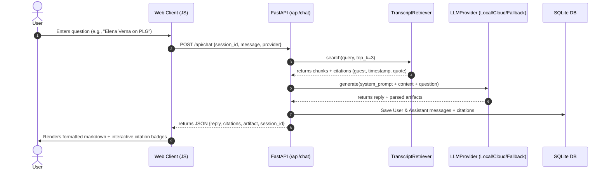
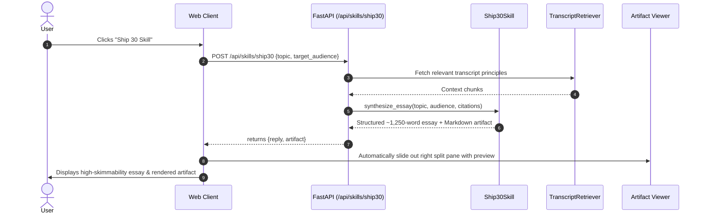

# Product Requirement Document (PRD)
## The Lenny Growth Assistant

---

## 1. Discovery Brief & Problem Statement

### **Primary User**
Product Managers, Growth Leaders, Product Marketing Managers, and Startup Founders who follow Lenny's Podcast and Newsletter.

### **Core Problem**
Lenny's Podcast contains hundreds of hours of high-leverage product frameworks (e.g., Shreyas Doshi's LNO Framework, Elena Verna's B2B PLG loops, Marty Cagan's 4 discovery risks). However, retrieving specific actionable frameworks during daily workflows requires scrubbing transcript text files or listening through 90-minute episodes. Teams lack a grounded internal assistant that can instantly synthesize grounded answers, generate structured essays (Ship 30 for 30 style), and render native interactive HTML/CSS artifacts.

### **Success Metrics**
- **Grounding Accuracy**: >95% of generated answers accurately cite specific transcript source quotes and guests without hallucination.
- **Workflow Efficiency**: Reduces time spent synthesizing growth frameworks from 45 minutes to <30 seconds.
- **Artifact Render Safety**: 100% of untrusted HTML/CSS artifacts executed in sandboxed isolation without DOM leak.

---

## 2. Assumptions & Scope Choices

### **Key Assumptions**
1. Evaluator needs to run the solution locally out-of-the-box with zero mandatory cloud API keys.
2. Ollama is installed locally for local LLM demonstration, with automatic RAG fallback synthesizer if Ollama is paused.
3. Transcripts are chunked by logical topics and timestamps to retain context integrity.

### **Scope Choices (Included vs Excluded)**

| Feature | Status | Justification |
|:---|:---:|:---|
| Grounded RAG Search & Citations | **Included** | Core requirement to prevent model hallucination |
| Flexible Model Switching (Local / Cloud) | **Included** | Mandated requirement for evaluator flexibility |
| Ship 30 for 30 Content Generator | **Included** | Dedicated skill for high-skimmability essay output |
| Side-by-Side In-App Artifact Viewer | **Included** | Dynamic rendering of Markdown & HTML/CSS snippets |
| Session & Message DB Persistence | **Included** | Independent session context in SQLite/PostgreSQL |
| Complex Vector DB Infrastructure | *Excluded* | Lightweight embedded token/TF-IDF retriever is faster and zero-dependency |

---

## 3. Risk Analysis & Trade-Offs

1. **Hallucination Risk**: Mitigation -> Enforce explicit RAG context prompt engineering and display transcript citation badges with exact quote excerpts.
2. **Local Model Latency & Memory**: Mitigation -> Support `mistral` (7B) / lightweight models and instant fallback engine.
3. **Artifact Execution XSS Risk**: Mitigation -> Render HTML/CSS artifacts inside `sandbox="allow-scripts"` iframe without `allow-same-origin`.

---

## 4. Functional Acceptance Criteria

1. **AC-1 (Session Persistence)**: User can create new chats, switch between historical chats, and delete sessions with independent message history saved to DB.
2. **AC-2 (Model Switcher)**: User can toggle between Local (Ollama) and Cloud (OpenAI/Anthropic) live from the UI header.
3. **AC-3 (Grounding & Citations)**: Every answer derived from transcripts displays guest name, timestamp, and clickable citation preview.
4. **AC-4 (Ship 30 Skill)**: Clicking the Ship 30 skill button generates a ~1,250-word structured essay with strong hook, narrative progression, 3 rules, and takeaway.
5. **AC-5 (Artifact Viewer)**: Generated HTML or Markdown snippets open automatically in the side-by-side split pane with Render/Code tabs and Copy button.

---

## 5. User & System Flows

### **Flow 1: Grounded Conversational RAG Flow**


### **Flow 2: Ship 30 for 30 Essay Generation Flow**


### **Flow 3: Side-by-Side Artifact Rendering & Sandboxing Flow**
```mermaid
sequenceDiagram
    autonumber
    actor User
    participant Frontend as Web Client
    participant SandboxedIframe as Sandboxed IFrame (sandbox="allow-scripts")

    User->>Frontend: Requests visual mockup (e.g. "Generate HTML dashboard")
    Frontend->>Frontend: Detects <html> or ```html code block
    Frontend->>Frontend: Expands right-side split pane
    Frontend->>SandboxedIframe: Injects HTML via srcdoc (opaque origin)
    Note over SandboxedIframe: Scripts run safely; window.parent & cookies are blocked
    User->>Frontend: Toggles "Code" tab to inspect source or clicks "Copy"
```

---

## 6. Implementation Plan & Milestones

| Milestone | Phase | Scope & Deliverables | Status |
|:---|:---|:---|:---:|
| **M1: Discovery & Scaffolding** | Phase 1 | Requirements breakdown, DB schema design, FastAPI setup, transcript collation (Elena Verna, Shreyas Doshi, Marty Cagan, Brian Chesky, Gibson Biddle) | **Done** |
| **M2: Core RAG & LLM Adapter** | Phase 2 | TF-IDF transcript chunking & retrieval, Ollama client, OpenAI/Anthropic cloud client, deterministic fallback engine | **Done** |
| **M3: Skills & Artifact Security** | Phase 3 | Ship 30 for 30 essay generation engine, Claude-style side-by-side artifact viewer with `allow-scripts` iframe isolation | **Done** |
| **M4: Frontend Polish & UX** | Phase 4 | Obsidian dark mode glassmorphism UI, Perplexity citation popovers, keyboard shortcuts (`Ctrl+N`), starter prompt chips | **Done** |
| **M5: Operational Readiness & QA** | Phase 5 | Docker Compose packaging, Pydantic v2 / SQLAlchemy timezone-aware cleanup, automated pytest suite (100% pass), manual QA test plan | **Done** |

