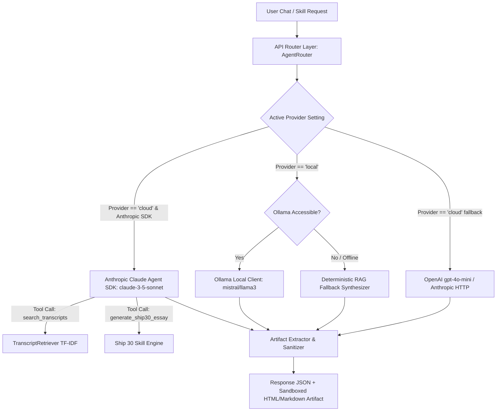

# Architecture Specification
## The Lenny Growth Assistant

---

## 1. System Topology & Component Boundaries

```
 +-----------------------------------------------------------------------+
 |                     BROWSER FRONTEND (HTML / CSS / JS)               |
 |  +--------------------+  +--------------------+  +-----------------+  |
 |  |  Chat Interface    |  | Model Selector UI  |  | Artifact Viewer |  |
 |  +--------------------+  +--------------------+  +-----------------+  |
 +-----------------------------------:-----------------------------------+
                                     | HTTP / REST API
 +-----------------------------------v-----------------------------------+
 |                        FASTAPI BACKEND SERVER                        |
 |  +--------------------+  +--------------------+  +-----------------+  |
 |  | Session & Chat API |  | Ship 30 Skill API  |  | Artifact API    |  |
 |  +---------:----------+  +---------:----------+  +--------:--------+  |
 |            |                       |                      |           |
 |  +---------v-----------------------v----------------------v--------+  |
 |  |                      ORCHESTRATOR LAYER                         |  |
 |  |  - RAG Retriever Engine (data/transcripts/*.json)               |  |
 |  |  - Unified LLM Provider (Ollama Local / OpenAI Cloud / Fallback)|  |
 |  |  - Artifact Extraction & Security Sanitization                 |  |
 |  +---------------------------------:-------------------------------+  |
 +------------------------------------:----------------------------------+
                                      | SQLAlchemy ORM
 +------------------------------------v----------------------------------+
 |                   DATABASE PERSISTENCE ENGINE                         |
 |  - SQLite (default for zero-config local run)                         |
 |  - PostgreSQL (supported via DATABASE_URL env)                        |
 +-----------------------------------------------------------------------+
```

---

## 2. Database Schema

### `sessions` Table
- `id` (VARCHAR(36), PK): UUID session identifier
- `title` (VARCHAR(255)): Conversation title
- `created_at` (TIMESTAMP): Session creation timestamp
- `updated_at` (TIMESTAMP): Last message timestamp
- `provider` (VARCHAR(50)): Active LLM provider (`local` / `cloud`)
- `model_name` (VARCHAR(100)): Active model name (`mistral` / `gpt-4o-mini`)

### `messages` Table
- `id` (VARCHAR(36), PK): Message UUID
- `session_id` (VARCHAR(36), FK -> sessions.id): Related session
- `sender` (VARCHAR(20)): `user` or `assistant`
- `content` (TEXT): Message content (markdown)
- `citations_json` (TEXT): JSON serialized list of source citations
- `artifact_id` (VARCHAR(36), FK -> artifacts.id, Nullable): Linked artifact

### `artifacts` Table
- `id` (VARCHAR(36), PK): Artifact UUID
- `session_id` (VARCHAR(36), FK -> sessions.id): Related session
- `title` (VARCHAR(255)): Artifact display name
- `artifact_type` (VARCHAR(50)): `html` or `markdown`
- `content` (TEXT): Code content
- `created_at` (TIMESTAMP): Generation timestamp

---

## 3. RAG Retrieval & Citation Flow

1. User sends query string to `/api/chat`.
2. `TranscriptRetriever` queries Ollama `nomic-embed-text` for the 768-dimensional query vector and tokenizes query terms.
3. Chunks are scored via **Hybrid Evaluation**:
   - **Semantic Cosine Similarity**: Compares query vector with pre-cached transcript chunk embeddings (`0.60` weight).
   - **Lexical Keyword Weighting**: Evaluates guest match (+3.0), topic match (+2.5), title match (+2.0), and text frequency (+2.0) (`0.40` weight).
   - **Automatic Resilience**: If Ollama embeddings are unavailable, automatically falls back to 100% lexical TF-IDF scoring.
4. Top 3 matching chunks are extracted and formatted into structured prompt context.
5. `LLMProvider` generates response and attaches structured `Citation` objects (Guest, Title, Timestamp, Excerpt Quote).

---

## 4. Security & Artifact Sandboxing Strategy

- **Threat**: Executing arbitrary LLM-generated HTML/CSS/JS code directly in the main web page window exposes the app to Cross-Site Scripting (XSS), cookie theft, and DOM manipulation.
- **Sanitization Strategy**:
  - All rendered HTML artifacts are served inside an `<iframe>` container.
  - The iframe includes strict security attributes: `sandbox="allow-scripts"`.
  - **Explicit Exclusion**: `allow-same-origin` is omitted. This ensures the executed iframe content operates in a unique opaque origin, blocking access to `window.parent`, `localStorage`, `sessionStorage`, cookies, and local domain APIs.

---

## 5. REST API Endpoints Specification

| Method | Endpoint | Request Body | Response Body | Description |
|:---|:---|:---|:---|:---|
| `GET` | `/api/health` | None | `{status, service, transcripts_loaded, ollama_status, database_status}` | Operational health and readiness probe |
| `GET` | `/api/models` | None | `{default_provider, providers: {local: {...}, cloud: {...}}}` | Discoverable model and provider metadata |
| `POST` | `/api/sessions` | `{title?: string}` | `{id, title, created_at, updated_at, provider, model_name}` | Initializes an isolated conversational session |
| `GET` | `/api/sessions` | None | `Array<SessionResponse>` | Lists recent sessions ordered by `updated_at DESC` |
| `GET` | `/api/sessions/{id}/messages` | None | `Array<MessageResponse>` | Retrieves ordered conversation history for session |
| `DELETE` | `/api/sessions/{id}` | None | `{status: "deleted", session_id}` | Cascading deletion of session, messages, and artifacts |
| `POST` | `/api/chat` | `{session_id?: string, message: string, provider?: string, model?: string}` | `{reply: string, session_id: string, citations: [...], artifact?: {...}}` | Main RAG conversation pipeline with citations & artifacts |
| `POST` | `/api/skills/ship30` | `{session_id?: string, topic: string, target_audience?: string}` | `{reply: string, session_id: string, citations: [...], artifact?: {...}}` | Synthesizes ~1,250-word Ship 30 essay artifact |
| `GET` | `/api/artifacts/{id}` | None | `{id, session_id, title, artifact_type, content, created_at}` | Fetches raw artifact content |
| `GET` | `/api/ingest` | None | `{status, total_chunks, transcripts: [...]}` | Reports knowledge base indexing status |

---

## 6. Agent Routing & Model Toggle Layer



### 6.1 Anthropic Claude Agent SDK Tool Loop
When cloud execution is active with `ANTHROPIC_API_KEY`:
1. `AnthropicClaudeAgent` (`app/llm/anthropic_agent.py`) initializes `anthropic.AsyncAnthropic`.
2. Registers autonomous tools:
   - `search_transcripts`: Queries Lenny's Podcast knowledge base and returns formatted excerpts and timestamps.
   - `generate_ship30_essay`: Dispatches topic to the Ship 30 for 30 structured essay synthesizer.
3. Executes a multi-turn tool-calling loop (`messages.create` with `tools=CLAUDE_AGENT_TOOLS`, processing `tool_use` blocks and returning grounded responses).
4. If the cloud key is unset, seamlessly routes to Ollama local model or the deterministic embedded synthesizer.


---

## 7. Deployment Topology

### Mode 1: Bare Metal / Local Python
- Host runs Python 3.10+ directly with Uvicorn worker process.
- Database: PostgreSQL (via local instance, Docker, or hosted Supabase/Railway via `DATABASE_URL`), with automatic SQLite fallback for zero-install developer convenience.
- Ollama: runs as local background daemon on `http://127.0.0.1:11434`.

### Mode 2: Docker Compose Multi-Container Topology (Production Ready)
- **Database Service (`db`)**: Official `postgres:16-alpine` container with automated healthcheck (`pg_isready`), dedicated port `5432:5432`, and named volume `postgres_data` for durable storage.
- **Application Service (`app`)**: `lenny_growth_assistant` FastAPI backend + UI, depending on `db` healthcheck.
- **Network Bridge**: Accesses host Ollama via `http://host.docker.internal:11434`.
- **Database Connection**: Automatically configured to `postgresql://postgres:postgrespassword@db:5432/lenny_growth_db`.

